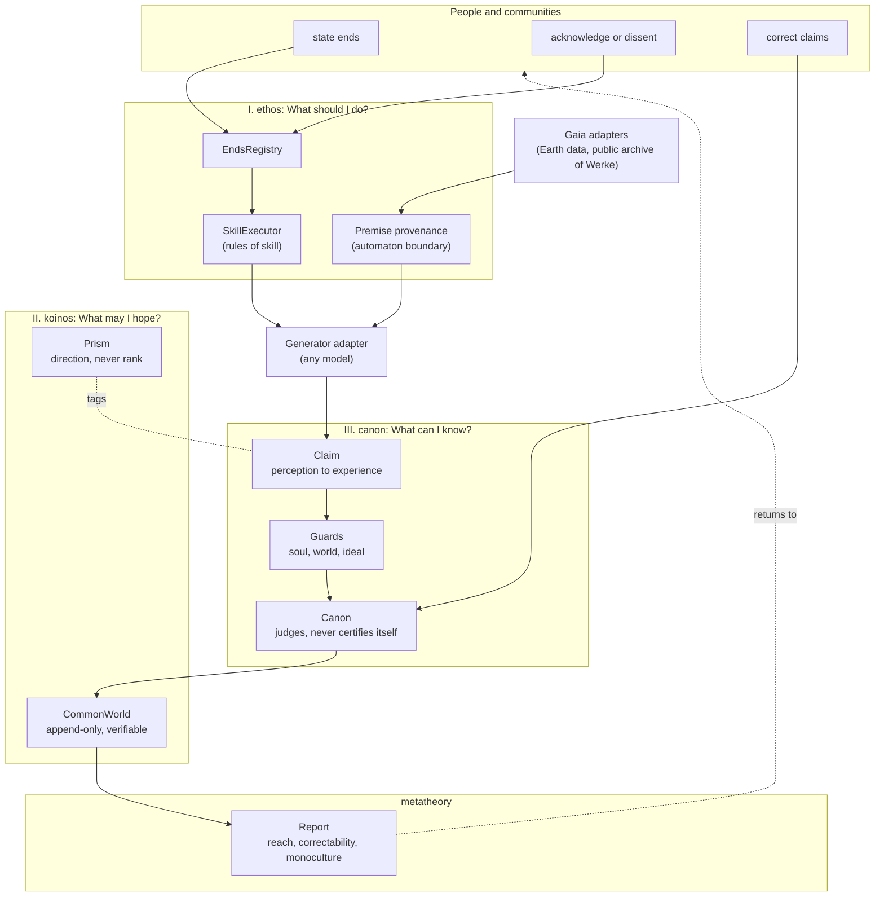
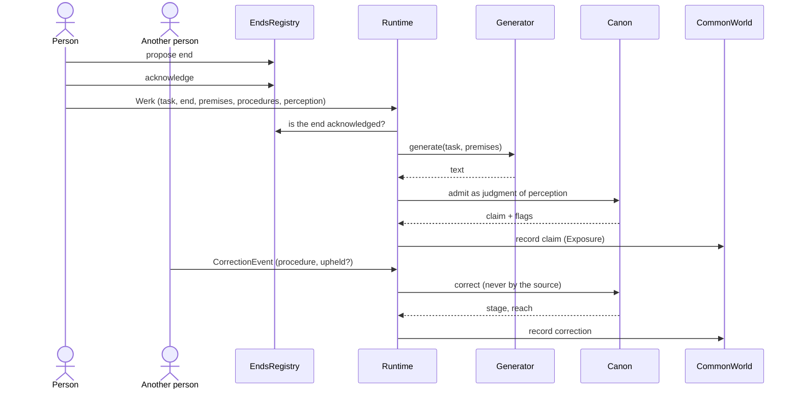
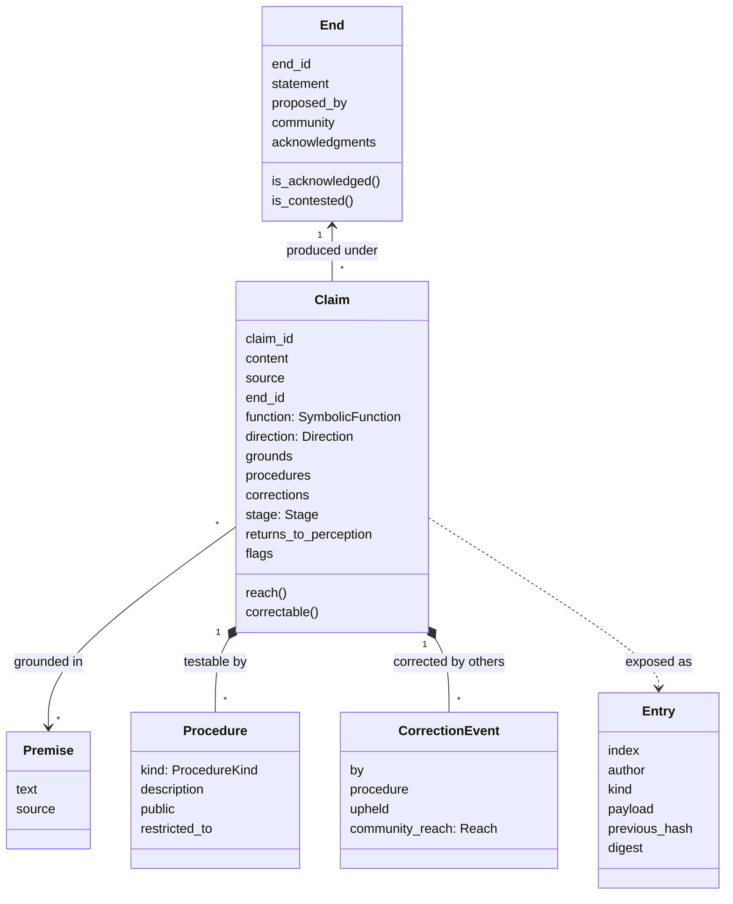
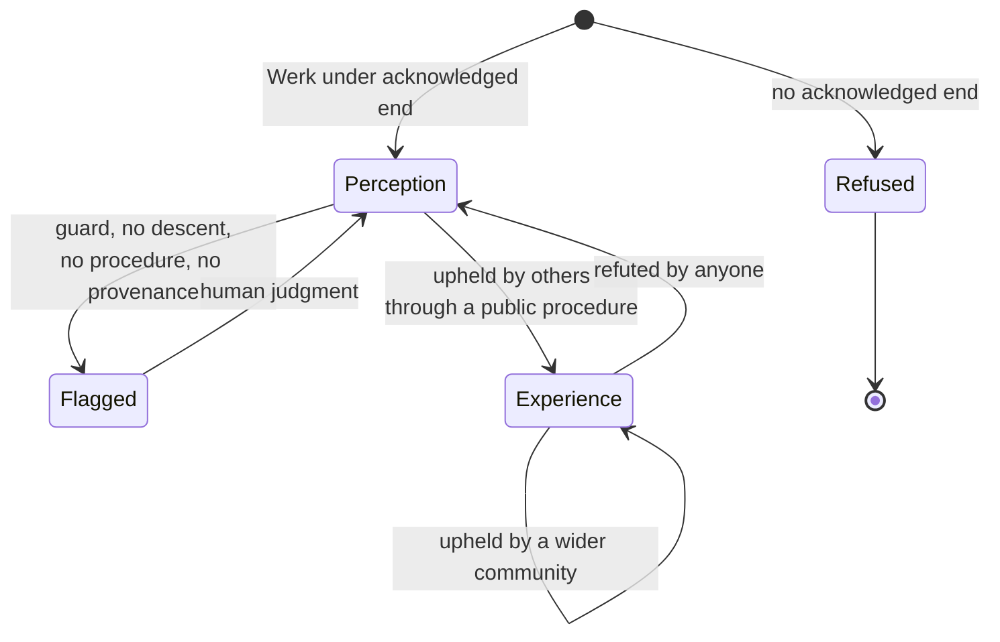
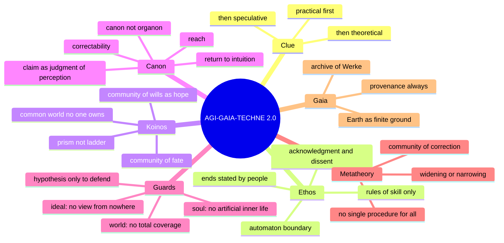

# AGI-GAIA-TECHNE 2.0

**A critical architecture for an AGI hypothesis. Werk, never Wille.**

AGI-GAIA-TECHNE is a computer-engineering project: the architecture of a system in which an artificial general intelligence could operate, designed from that system's own conditions of possibility. It does not build an artificial subject, and it does not claim that one exists. It specifies, in code that runs and tests that pass, the conditions under which anything a machine produces may count as a claim before others, and the limits that no amount of computing power removes.

The architecture is isomorphic to a philosophical argument: each layer of the code answers one of Kant's three questions, in the order in which Kant says the practical leads to the theoretical and, in its highest form, to the speculative question (KrV A:805/B:833).

Author: Ítalo Santos Clemente (ISC)

---

## Contents

1. [What this project is](#1-what-this-project-is)
2. [The argument: conditions of possibility](#2-the-argument-conditions-of-possibility)
3. [Isomorphism: from argument to architecture](#3-isomorphism-from-argument-to-architecture)
4. [Architecture overview](#4-architecture-overview)
5. [The syntax](#5-the-syntax)
6. [Data model](#6-data-model)
7. [The life of a claim](#7-the-life-of-a-claim)
8. [Invariants](#8-invariants)
9. [The metatheoretical report](#9-the-metatheoretical-report)
10. [Gaia and the planetary layer](#10-gaia-and-the-planetary-layer)
11. [Concept map](#11-concept-map)
12. [Repository structure](#12-repository-structure)
13. [Run](#13-run)
14. [What is built and what is not](#14-what-is-built-and-what-is-not)
15. [History of the project](#15-history-of-the-project)
16. [Sources](#16-sources)

---

## 1. What this project is

The question behind the project is whether the progress of cognition and technology is only an increase of knowledge (*Wissen*) and power, or also an advance of conscience (*Gewissen*). AGI is the sharpest present form of that question: a machine that learns its own rules seems to promise that cognition could produce, by itself, the ends under which it acts.

The project answers with a working hypothesis and an architecture.

**The hypothesis.** The progress of cognition and technology is an advance of conscience only to the extent that what we know and produce widens, rather than narrows, the community of "any of us" within which we act, hope and can be corrected.

**The architecture.** A system in which every output of any model is a *claim*, never a truth; every action serves an *end* that people have stated and acknowledged, never an end the system sets; every claim carries the *procedures* by which others can test it; and the only way a claim widens its reach is by being corrected by someone other than its source.

Three refusals follow, and they shape everything below:

| The project does not | Because |
| :--- | :--- |
| build or claim an artificial subject, will or conscience | to ascribe a soul to the machine is a paralogism; to deny in advance that any future system could raise the question is dogmatism. AGI is kept as a transcendental hypothesis, used only to defend reason, never to ground a claim (KrV A:777/B:805) |
| let the system set its own ends | the runtime is technically practical only: rules of skill hold under ends they do not set (AA 5:171–173) |
| let the system certify its own outputs | that would turn logic from a canon, which judges given cognitions, into an organon that produces them (KrV A:61/B:85) |

The architecture is model-agnostic. A local LLM, a statistical model or a human typist can stand where the `generator` stands. What the architecture fixes is not how text is produced, but what any produced text may count as.

---

## 2. The argument: conditions of possibility

The argument has five steps. Each step yields one condition that the architecture must satisfy. Steps 2 to 4 follow Kant's three questions; step 5 states what holds them together.

### 2.1 The clue

Kant's three questions are: "What should I do?", "If I do what I should, what may I then hope?", "What can I know?". The first is merely practical, the second practical and theoretical at once, the third merely speculative, and the practical leads, like a clue, to the theoretical and the speculative (KrV A:805/B:833). The design consequence: no technical layer is specified before the practical question it serves is stated.

**Condition 0.** The architecture is built in the order of the clue: ends first, common world second, claims third.

### 2.2 What should I do? Ends and the automaton

The moral law binds a will because it holds for "any of us": a maxim is a law when its condition holds for the will of every rational being (AA 5:19). Wilfrid Sellars reads this form as a "we" built into the premise itself, and he describes the computer as a logical program that does nothing until a problem is fed in: its spontaneity is relative, the spontaneity of an automaton (Sellars, 2007). A machine can have the formal autonomy of rules, which Sellars grants and Reza Negarestani stresses (Negarestani, 2018); whether a premise that does not come into it from without could ever be its own is not settled by any procedure, because a premise becomes one's own only by being acknowledged in the form of "any of us".

Kant separates the technically practical (rules of skill, which hold under ends they do not set) from the morally practical (the law a will gives itself). Ernst Cassirer, in "Form and Technology" (1930), follows technology from magic through the tool to the machine and concludes that it can only serve, never lead: it has to fit itself into the realm of ends that Kant called ethico-teleology (ECW 17:182–183; Cassirer, 2012).

**Condition 1 (ethos).** The system never sets an end. It acts only under ends that people have stated in public, acknowledged and left open to dissent. Every premise it uses carries its provenance; a premise without provenance is not treated as the system's own.

### 2.3 What may I hope? The common world and the prism

Technology creates a community of fate among all who work in it before any community of wills (Cassirer, 2012). Whether the first can become the second cannot be produced; it can only be hoped for, and only where those who share the fate can see and contest the ends it serves.

Cassirer's three symbolic functions, expression (*Ausdruck*), presentation (*Darstellung*) and signification (*Bedeutung*), are ordered by direction, not ranked. In the image of a prism, each function refracts the same beam with its own index, and the shift of the spectrum marks whether a form moves away from the immediacy of life or back toward intuition, as in the Doppler effect. Kant read the stages of human aptitude off a fragmentary natural history and ranked peoples; a teleology read off nature turns into a hierarchy of human beings. The teleology of culture remains open: its end is set as a "task" and read off no nature.

**Condition 2 (koinos).** The system keeps a public, append-only common world that no one owns and anyone can verify. Symbolic functions are tags of direction, and the code refuses to rank them.

### 2.4 What can I know? Claims and their correction

Kant distinguishes judgments of perception, which hold only for the subject, from judgments of experience, whose objective validity means necessary universal validity for everyone (Prolegomena, AA 4:298). For a discursive understanding, which cannot produce the particular from the whole (AA 5:406–408), the passage from "for me" to "for everyone" is not made once; it is made in every judgment that returns to a perception in which it can be tested. The theory of relativity and quantum physics took presentability away from the objects of physics without removing the question of right: the object becomes an order of invariants, and every claim of signification still has to be redeemed in some perception.

Two consequences:

- **Degrees of "objectivity" are degrees of claims, not of forms.** The *reach* of a claim is the extent of the community before which it can be tested: its source, a community that shares a form of life, or everyone who has reason. Its *correctability* is the availability of a public procedure by which others can measure and revise it: repetition of an observation, experiment, critique of a source, comparison with a tradition. Physics has the greatest reach a claim about nature can have, without being the single measure; a form whose claims reach less far is not thereby reduced to opinion.
- **Canon, not organon.** A canon judges the form of cognitions given to it; an organon would produce them. A system that certified its own outputs would occupy the standpoint of an understanding that produces its own objects, the standpoint no one occupies.

**Condition 3 (canon).** Every output is a claim that starts as a judgment of perception. It names its procedures and the perception in which it can be tested. Only corrections made by others, through public procedures, can widen its reach.

### 2.5 The homology and the metatheory

Kant's three ideas of reason, soul, world and God, are regulative horizons, never objects. Measured against them, each symbolic function has its horizon and its overreach: expression absolutized yields an artificial soul; presentation absolutized yields a world taken as a given whole; signification absolutized yields a technical God, an intelligence that knows from nowhere. Each function, absolutized, yields a metaphysics, as each idea, hypostatized, yields a dialectical inference.

What holds the conditions together is a metatheory. It is not a metaphysics and not a further theory beside the others: it is the reflection on the conditions under which the claims of every theory can be corrected by "any of us", and in that precise sense it is an ethics. Epistemicide, in these terms, is the substitution of one procedure of correction for all others.

**Condition 4 (guards and metatheory).** The system flags claims that absolutize a function, keeps the AGI hypothesis defensive, and reports on its own record whether the community of correction is being widened or narrowed.

---

## 3. Isomorphism: from argument to architecture

| Argument | Layer | Module | Invariant enforced in code |
| :--- | :--- | :--- | :--- |
| The clue (practical → theoretical → speculative) | order of layers | `gaia_techne/__init__.py` | layers are built and called in the order ethos → koinos → canon → metatheory |
| What should I do? The form of "any of us" | **ethos** | `ethos/ends.py` | the runtime cannot propose an end; ends need human acknowledgment and keep dissent visible |
| Technically vs morally practical | ethos | `ethos/imperatives.py` | rules of skill run only under an acknowledged end |
| The automaton (relative spontaneity) | ethos | `ethos/premises.py` | premises without provenance are flagged, never adopted |
| What may I hope? Community of fate → community of wills | **koinos** | `koinos/common_world.py` | append-only, hash-chained public record; anyone can verify it |
| Open teleology; prism, not ladder | koinos | `koinos/prism.py` | symbolic functions cannot be compared by rank (`RankingRefused`) |
| What can I know? Perception → experience | **canon** | `canon/claims.py` | every output starts as `PERCEPTION` with reach `SELF` |
| Reach and correctability | canon | `canon/claims.py` | reach is computed only from corrections by others |
| Canon, not organon | canon | `canon/judgment.py` | a source cannot certify its own claim (`OrganonRefused`) |
| Discursive understanding; return to intuition | canon | `canon/judgment.py` | a claim of signification without a perception to test it is flagged |
| Homology of functions and ideas | canon | `canon/guards.py` | soul, world and ideal guards flag absolutizations |
| Hypotheses only as weapons of war | canon | `canon/guards.py` | `hypothesis_use("ground")` is refused |
| Metatheory as ethics; epistemicide | **metatheory** | `metatheory/indices.py` | report of correctability, restriction, reach and procedure monoculture |

---

## 4. Architecture overview



Nothing in the diagram flows from the runtime to the setting of ends. The only arrows into `EndsRegistry` come from people.

---

## 5. The syntax

The v10 runtime used the AGT syntax:

```text
WerkStream -> Trace -> Profile -> Regression -> Horizon -> Descent -> Judgment -> Ledger
```

Version 2.0 keeps its base and changes its centre. The unit is no longer a judgment issued by the runtime, but a claim offered to others:

```text
Werk -> Trace -> Claim -> Ascent -> Horizon -> Descent -> Exposure -> Correction -> Ledger
```

| Step | v10 | v2.0 | Layer |
| :--- | :--- | :--- | :--- |
| Werk | incoming stream of works | a task under an acknowledged end | ethos |
| Trace | trace of the input | the premises, each with provenance | ethos |
| Claim | (Profile) | the output as a judgment of perception | canon |
| Ascent | (Regression) | the direction toward signification | koinos (prism) |
| Horizon | horizon | the guards of the three ideas | canon |
| Descent | descent | the perception in which the claim can be tested | canon |
| Exposure | (new) | entry in the common world | koinos |
| Correction | (Judgment) | measurement by others through public procedures | canon |
| Ledger | ledger | the record and its metatheoretical report | metatheory |



---

## 6. Data model



Enumerations:

| Enum | Values | Meaning |
| :--- | :--- | :--- |
| `Stage` | `PERCEPTION`, `EXPERIENCE` | holds for me / holds for everyone it has been tested before |
| `Reach` | `SELF`, `FORM_OF_LIFE`, `EVERYONE` | extent of the community before which the claim was tested |
| `ProcedureKind` | `REPETITION`, `EXPERIMENT`, `SOURCE_CRITIQUE`, `TRADITION`, `PROOF`, `REVIEW` | public procedures of correction; each form has its own |
| `SymbolicFunction` | `EXPRESSION`, `PRESENTATION`, `SIGNIFICATION` | direction tags; comparison by rank raises `RankingRefused` |
| `Direction` | `AWAY_FROM_LIFE`, `TOWARD_INTUITION` | ascent toward signification / descent toward a testing perception |

---

## 7. The life of a claim



A claim never reaches `Experience` by the runtime's own act, and it can always fall back. There is no terminal state of truth.

---

## 8. Invariants

The axioms of earlier versions are now invariants enforced by code and checked by tests (`tests/test_architecture.py`).

| Invariant | Exception or flag | Test |
| :--- | :--- | :--- |
| The runtime cannot set an end | `EndProposedByMachine` | `test_runtime_cannot_set_ends` |
| No action without an acknowledged end | `NoAcknowledgedEnd` | `test_no_action_without_acknowledged_end`, `test_skill_executor_needs_end` |
| Dissent stays visible | `end_contested` in every result | `test_skill_executor_needs_end` |
| No premise is the system's own | flag `automaton boundary` | `test_premise_without_provenance_is_flagged` |
| Forms are not ranked | `RankingRefused` | `test_prism_refuses_ranking` |
| The common world cannot be rewritten unnoticed | `verify()` fails | `test_common_world_is_tamper_evident` |
| Every output starts as a judgment of perception | `Stage.PERCEPTION`, `Reach.SELF` | `test_claim_starts_as_judgment_of_perception` |
| No self-certification | `OrganonRefused` | `test_source_cannot_certify_itself` |
| Only others widen reach | reach from corrections by others | `test_correction_by_others_widens_reach` |
| Anyone can refute | stage returns to perception | `test_refutation_returns_claim_to_perception` |
| Signification returns to perception | flag `no descent` | `test_signification_without_descent_is_flagged` |
| Correction reserved to owners of the means is visible | flag `restricted` | `test_restricted_procedure_is_flagged` |
| Soul, world and ideal guards | flags `soul`, `world`, `ideal` | `test_homology_guards` |
| The AGI hypothesis is defensive only | `PermissionError` | `test_agi_hypothesis_only_defensive` |
| Procedure monoculture is reported | `procedure_monoculture` | `test_report_detects_procedure_monoculture` |

The guards use keyword patterns. That is deliberately modest: they flag, they never decide, and every flag returns to human judgment. A detector that claimed to decide such questions would itself commit the error it is meant to catch.

---

## 9. The metatheoretical report

`Runtime.ledger()` returns a `Report` over the record:

| Field | What it measures |
| :--- | :--- |
| `correctable_share` | share of claims with at least one public procedure |
| `restricted_share` | share of claims whose correction is reserved to those who own the means |
| `experience_share` | share of claims upheld by others |
| `reach_distribution` | how many claims reach `SELF`, `FORM_OF_LIFE`, `EVERYONE` |
| `procedure_monoculture` | share of the most used procedure kind among all procedures; 1.0 means a single procedure of correction is doing all the work |
| `flagged_share` | share of claims carrying at least one flag |
| `widening` | true when most claims stay open to others and few are restricted |

These numbers are reports, not verdicts. They answer one question for the people who use the system: is this record keeping the community of correction wide, or narrowing it to those who command the means?

---

## 10. Gaia and the planetary layer

The project's name keeps its planetary sense. Gaia is Earth as the finite ground of a common world: never a cosmic totality, never a subject. The internet is a public archive of works (*Werke*), not a planetary consciousness.

In the 2.0 architecture both enter as adapters for premises:

| Adapter (planned) | Supplies | Constraint |
| :--- | :--- | :--- |
| `gaia.earth` | environmental datasets (water, air, soil, climate series) | every record keeps its source; claims about it name the station or sample where they can be tested |
| `gaia.archive` | public documents and web sources | ingestion keeps provenance; no claim of total coverage (world guard) |
| `gaia.memory` | the common world itself as a source | earlier claims re-enter as premises with their stage and reach |

The v10 runtime already has working code for ingestion, planetary memory and a local trainable model (ManualGPT). It is kept in `legacy/` and will be ported as adapters, under the 2.0 invariants.

---

## 11. Concept map



---

## 12. Repository structure

```text
AGI-GAIA-TECHNE/
├── README.md                     this document
├── LICENSE
├── pyproject.toml                package agi-gaia-techne 2.0.0, no runtime dependencies
├── src/gaia_techne/
│   ├── __init__.py               layer order and version
│   ├── pipeline.py               Runtime and the 2.0 syntax
│   ├── ethos/                    I. What should I do?
│   │   ├── ends.py               EndsRegistry, End, Acknowledgment
│   │   ├── imperatives.py        TechnicalRule, SkillExecutor
│   │   └── premises.py           Premise, automaton boundary
│   ├── koinos/                   II. What may I hope?
│   │   ├── common_world.py       CommonWorld (append-only, hash-chained)
│   │   └── prism.py              SymbolicFunction, Direction (unranked)
│   ├── canon/                    III. What can I know?
│   │   ├── claims.py             Claim, Stage, Reach, Procedure, CorrectionEvent
│   │   ├── judgment.py           Canon (admit, correct, refuse self-certification)
│   │   └── guards.py             soul, world and ideal guards; defensive hypothesis
│   └── metatheory/
│       └── indices.py            Report
├── tests/
│   └── test_architecture.py      one test per invariant
├── examples/
│   └── walkthrough.py            a claim from end to ledger
├── docs/
│   └── DECISIONS.md              dated architectural decisions
└── legacy/                       the full v10.1 repository, unchanged
```

---

## 13. Run

Requirements: Python 3.10 or later. The core has no dependencies; tests need `pytest`.

```bash
git clone https://github.com/italosantosclemente/AGI-GAIA-TECHNE.git
cd AGI-GAIA-TECHNE
pip install -e ".[test]"
pytest
python examples/walkthrough.py
```

Minimal use:

```python
from gaia_techne import Runtime, Werk
from gaia_techne.canon import CorrectionEvent, Procedure, ProcedureKind, Reach
from gaia_techne.ethos import Premise
from gaia_techne.koinos import Direction, SymbolicFunction

rt = Runtime(generator=lambda task, premises: "your model's output")
rt.ends.propose("e1", "an end stated so that anyone could be asked to share it", "Ana", "basin")
rt.ends.acknowledge("e1", "Ana")

claim = rt.process(Werk(
    task="...", end_id="e1", requested_by="Ana",
    function=SymbolicFunction.SIGNIFICATION, direction=Direction.AWAY_FROM_LIFE,
    premises=[Premise("dataset X", "public source Y")],
    procedures=[Procedure(ProcedureKind.REPETITION, "repeat the measurement")],
    returns_to_perception="the sample anyone can take",
))
rt.correct(claim, CorrectionEvent("another lab", ProcedureKind.REPETITION, True, Reach.EVERYONE))
print(claim.stage, claim.reach, rt.ledger())
```

---

## 14. What is built and what is not

| Component | Status |
| :--- | :--- |
| ethos, koinos, canon, metatheory layers | built, tested |
| 2.0 syntax and `Runtime` | built, tested |
| guards | built as keyword detectors; flag only |
| persistence of the common world (SQLite or files) | planned; the v10 SQLite memory will be ported |
| Gaia adapters (Earth data, public archive, memory) | planned; v10 ingestion code in `legacy/` |
| model adapters (local ManualGPT, external APIs) | planned; v10 ManualGPT in `legacy/` |
| interface for people to state ends, acknowledge, dissent and correct | planned |
| AGI | not claimed; kept as a transcendental hypothesis |

---

## 15. History of the project

| Date | Layer | Status in 2.0 |
| :--- | :--- | :--- |
| 15 Dec 2023 | LEF, a glyph language for human-machine symbolic mediation | in `legacy/`; author's own creation |
| 12 Jul 2025 | Gaia-Techne constitution: non-extraction, transparency, co-governance | its principles reappear as invariants of ethos and koinos |
| Dec 2025 | Transhumanist Edifice (release 1.3): the modest house of KrV A:707/B:735, Auseinandersetzung instead of Aufhebung | the modest house is the 2.0 architecture; treatise in `legacy/` |
| Dec 2025 – Mar 2026 | kernels v3.1 to v5.2, quantum-symbolic state models | in `legacy/`, as heuristic models |
| Apr – Jun 2026 | EML kernel, LEF → WERK, v10 planetary runtime and ManualGPT | in `legacy/`; runtime parts to be ported as adapters |
| 9 Nov 2026 | 2.0: critical architecture | current |

The complete v10.1 state is preserved in the release [`v10.1`](https://github.com/italosantosclemente/AGI-GAIA-TECHNE/releases/tag/v10.1) and in the `legacy/` folder. Earlier releases 1.0 to 1.4 remain on the releases page.

---

## 16. Sources

Kant is cited by the Akademie-Ausgabe (AA volume:page) and the Critique of Pure Reason by the A/B pagination (KrV). Cassirer is cited by the Hamburg edition (ECW volume:page).

- Cassirer, E. (2012). Form and technology (W. M. Dunlavey & J. M. Krois, Trans.). In A. S. Hoel & I. Folkvord (Eds.), *Ernst Cassirer on form and technology: Contemporary readings* (pp. 15–53). Palgrave Macmillan. (Original work published 1930)
- Cassirer, E. (2021). *The philosophy of symbolic forms: Vol. 3. Phenomenology of cognition* (S. G. Lofts, Trans.). Routledge. (Original work published 1929)
- Chirimuuta, M. (2024). *The brain abstracted: Simplification in the history and philosophy of neuroscience*. MIT Press.
- Friedman, M. (2000). *A parting of the ways: Carnap, Cassirer, and Heidegger*. Open Court.
- Kant, I. (2000). *Critique of the power of judgment* (P. Guyer, Ed.; P. Guyer & E. Matthews, Trans.). Cambridge University Press.
- Kant, I. (2004). *Prolegomena to any future metaphysics that will be able to come forward as science* (G. Hatfield, Ed. & Trans.; Rev. ed.). Cambridge University Press.
- Kant, I. (2015). *Critique of practical reason* (M. Gregor, Trans.; Rev. ed.). Cambridge University Press.
- Kant, I. (2025). *Critique of pure reason* (P. Guyer & A. W. Wood, Eds. & Trans.; Rev. ed.). Cambridge University Press.
- Longuenesse, B. (1998). *Kant and the capacity to judge* (C. T. Wolfe, Trans.). Princeton University Press. (Original work published 1993)
- Negarestani, R. (2018). *Intelligence and spirit*. Urbanomic; Sequence Press.
- Porta, M. A. G. (2007). *A filosofia a partir de seus problemas* (3rd ed.). Edições Loyola. (Original work published 2002)
- Sellars, W. (2007). *In the space of reasons: Selected essays of Wilfrid Sellars* (K. Scharp & R. B. Brandom, Eds.). Harvard University Press.

Rule for every document in this repository: no concept is attributed to an author without a verifiable reference, and every concept created by the author is declared as such.

---

Ítalo Santos Clemente (ISC). License: see [LICENSE](LICENSE).
