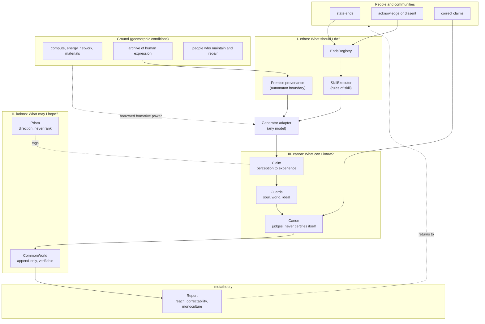
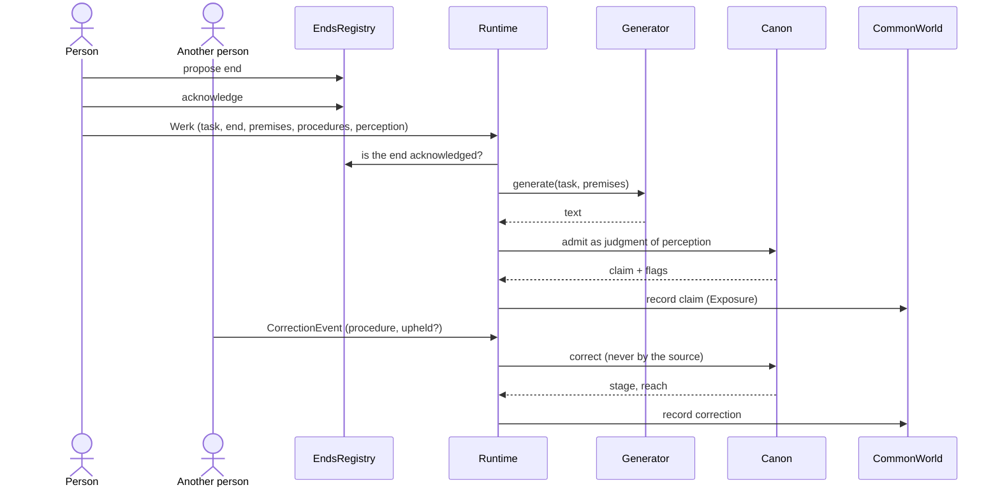
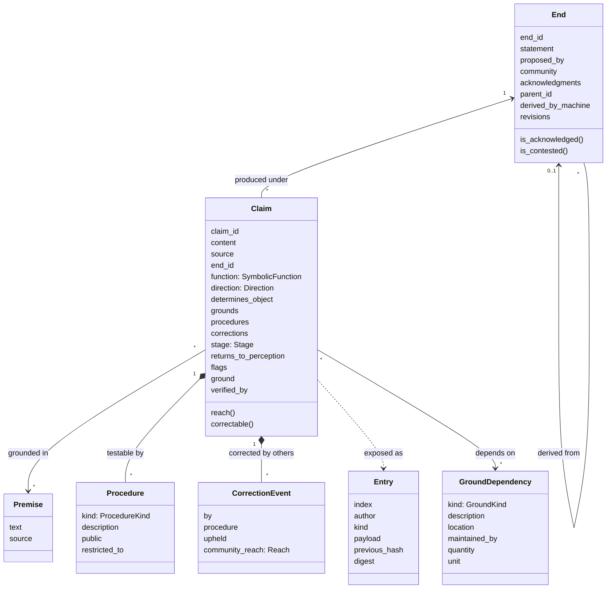
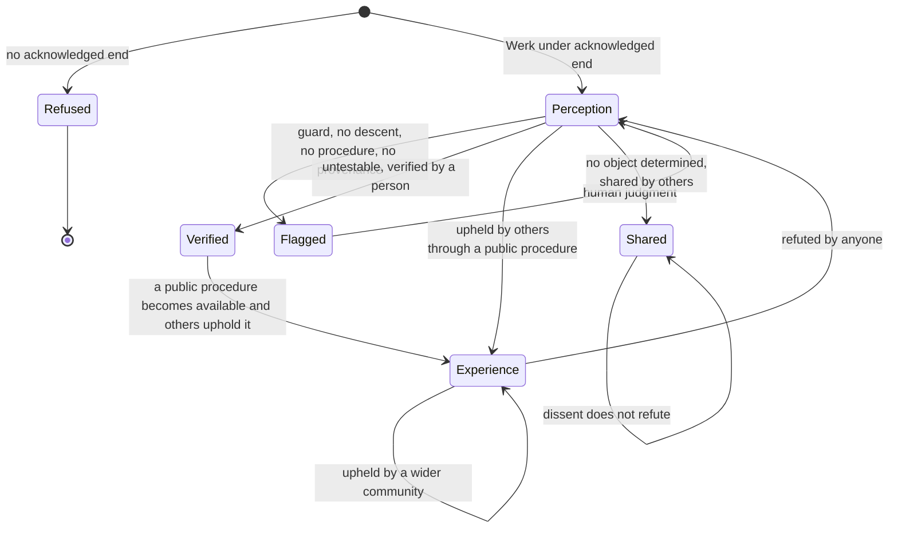
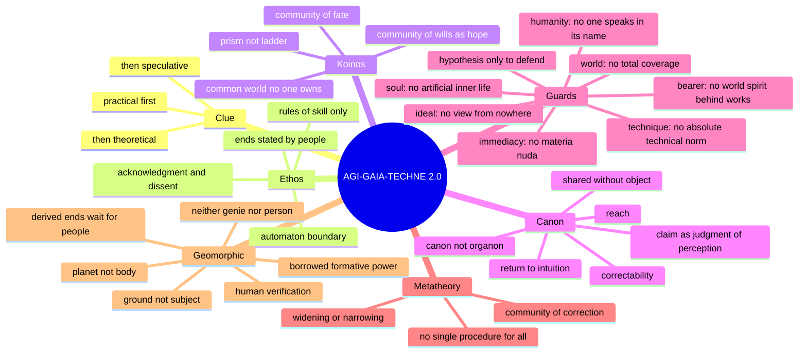

# AGI-GAIA-TECHNE 2.0

**A critical architecture for an AGI hypothesis. Werk, never Wille.**

AGI-GAIA-TECHNE is a computer-engineering project: the architecture of a system in which an artificial general intelligence could operate, designed from that system's own conditions of possibility. It does not build an artificial subject, and it does not claim that one exists. It specifies, in code that runs and tests that pass, the conditions under which anything a machine produces may count as a claim before others, and the boundaries that no amount of computing power crosses.

The architecture is isomorphic to a philosophical argument: each layer of the code answers one of Kant's three questions, in the order in which Kant says the practical leads to the theoretical and, in its highest form, to the speculative question (KrV A:805/B:833).

Its central hypothesis is **geomorphic**. The conditions of possibility of the machine expected to become a general intelligence are not those of a body but those of a planet: data centres, networks, energy and materials, together with an archive of human expression that no single consciousness has lived through. Such a machine stays on the side of mechanism, and the formative power it seems to have is borrowed from the people and the planet on which it depends. The architecture is built on that ground.

Author: Ítalo Santos Clemente (ISC)

---

## Contents

1. [What this project is](#1-what-this-project-is)
2. [The argument: conditions of possibility](#2-the-argument-conditions-of-possibility)
3. [Isomorphism: from argument to architecture](#3-isomorphism-from-argument-to-architecture)
4. [Architecture overview](#4-architecture-overview)
5. [The syntax](#5-the-syntax)
6. [Data model](#6-data-model)
7. [The life of a claim](#7-the-life-of-a-claim)
8. [Invariants](#8-invariants)
9. [The metatheoretical report](#9-the-metatheoretical-report)
10. [Gaia and the planetary layer](#10-gaia-and-the-planetary-layer)
11. [Concept map](#11-concept-map)
12. [Repository structure](#12-repository-structure)
13. [Run](#13-run)
14. [What is built and what is not](#14-what-is-built-and-what-is-not)
15. [History of the project](#15-history-of-the-project)
16. [Sources](#16-sources)

---

## 1. What this project is

The question behind the project is whether the progress of cognition and technology is only an increase of knowledge (*Wissen*) and power, or also an advance of conscience (*Gewissen*). AGI is the sharpest present form of that question: a machine that learns its own rules seems to promise that cognition could produce, by itself, the ends under which it acts.

The project answers with a working hypothesis and an architecture.

**The hypothesis.** The progress of cognition and technology is an advance of conscience only to the extent that what we know and produce widens, rather than narrows, the community of "any of us" within which we act, hope and can be corrected.

**The architecture.** A system in which every output of any model is a *claim*, never a truth; every action serves an *end* that people have stated and acknowledged, never an end the system sets; every claim carries the *procedures* by which others can test it; and the only way a claim widens its reach is by being corrected by someone other than its source.

Three refusals follow, and they shape everything below:

| The project does not | Because |
| :--- | :--- |
| build or claim an artificial subject, will or conscience | to ascribe a soul to the machine is a paralogism; to deny in advance that any future system could raise the question is dogmatism. AGI is kept as a transcendental hypothesis, used only to defend reason, never to ground a claim (KrV A:777/B:805) |
| let the system set its own ends | the runtime is technically practical only: rules of skill hold under ends they do not set (AA 5:171–173) |
| let the system certify its own outputs | that would turn logic from a canon, which judges given cognitions, into an organon that produces them (KrV A:61/B:85) |

The architecture is model-agnostic. A local LLM, a statistical model or a human typist can stand where the `generator` stands. What the architecture fixes is not how text is produced, but what any produced text may count as.

---

## 2. The argument: conditions of possibility

The argument has six steps. Each step yields one condition that the architecture must satisfy. Steps 2 to 5 follow Kant's three questions, with the geomorphic condition inside the second; step 6 states what holds them together.

### 2.1 The clue

Kant's three questions are: "What should I do?", "If I do what I should, what may I then hope?", "What can I know?". The first is merely practical, the second practical and theoretical at once, the third merely speculative, and the practical leads, like a clue, to the theoretical and the speculative (KrV A:805/B:833). The design consequence: no technical layer is specified before the practical question it serves is stated.

The motto of the project, *Werk, never Wille*, comes from Cassirer's late map of metaphysics. In the manuscript on basic phenomena of 1940, metaphysics fails not by turning away from experience, but by singling out one "moment" of experience and declaring it the original and the being in itself (ECN 1:150–152). The map follows three classes of basic phenomena, and each yields a type of metaphysics: the first takes *life* for the core of being; the second makes the *will* (*Wille*) the ground of all being, either as blind drive or as the autonomous will of an ethical metaphysics; the third concerns the *work* (*Werk*), the being of culture and history, and fails when it explains the works through super-empirical bearers, such as the Romantic spirits of peoples or Hegel's world spirit (ECN 1:148–149, 152–158). The work is a lasting product that the human being sets out of himself; culture and history exist for us only in works, and since no work is that of an individual alone, but arises from a reciprocal action, the work is a social phenomenon (ECN 1:136–137, 155–156). Against these types, Cassirer sets Kant's method, which does not investigate the being of things, but the fact of determinate works, and asks how each work is possible (ECN 1:162–164). It is the analytic method of the *Prolegomena*: "one proceeds from that which is sought as if it were given, and ascends to the conditions under which alone it is possible" (AA 4:276n; Kant, 2004, p. 28).

The architecture follows this method. Its input is a `Werk`, a task brought by people under an end they acknowledge; the archive it draws on is an archive of works; its output is a claim about works, open to correction by others. It ascribes no will to the system, which stays technically practical (§2.2), and no super-empirical bearer to the works it processes: the planet, the network and the archive are not a world spirit (§2.4, §2.6).

**Condition 0.** The architecture is built in the order of the clue: ends first, common world second, claims third.

### 2.2 What should I do? Ends and the automaton

Every "ought" expresses a necessity of action, but in two senses. Either I ought to do something as a means if I will something else as an end, a necessity of means (*necessitas problematica*), which indicates no "binding" at all but only the solution of a problem; or I ought immediately to do something as an end, and a "binding" of this kind requires a supreme rule that is absolutely indemonstrable (AA 2:298–299). The Critique of Practical Reason states where such a rule holds: practical principles "are subjective, or maxims, when the condition is regarded by the subject as holding only for his will; but they are objective, or practical laws, when the condition is cognized as objective, that is, as holding for the will of every rational being" (AA 5:19; Kant, 2015, p. 17). What makes a practical principle "objective" is not its relation to an object, but its validity for the will of every rational being.

Wilfrid Sellars places the "we" in the form of the law itself: "Let any of us persons do that in each circumstance which promotes our common good", a principle he calls "logically intersubjective" (Sellars, 2007, p. 433), which yields practical propositions of the form "let any of us do A, if in C" (Sellars, 2007, p. 434). To recognize someone as a person is not to classify a being, but to take it as someone with whom one shares intentions of the form "We (one) shall do (or abstain from doing) actions of kind A in circumstances of kind C" (Sellars, 2007, p. 408).

Sellars also gives the model of the automaton. A computer that embodies a logical program "still does nothing unless a problem is 'fed in'", and the information it gets is information it is caused to have, "i.e. more input" (Sellars, 2007, p. 428): its spontaneity is relative. A practical reason that received purposes as input, added facts and delivered courses of action would be a "sausage machine": chunks of purpose meat go in at one end, purpose sausages come out at the other, and the customer is not practical reason itself but the one who brought the raw material (Sellars, 2007, p. 431). This is heteronomy. Kant's own image is the turnspit, "which, when once it is wound up, also accomplishes its movements of itself" (AA 5:97; Kant, 2015, p. 79), and the metaphysical lectures of the 1770s call such a merely relative spontaneity *spontaneitas automatica* (Allison, 1990, p. 60). For practical reason to be autonomous there must be a premise that belongs to it as intrinsically as its procedures do (Sellars, 2007, p. 431), and that premise has the form "any of us".

A machine can have the formal autonomy of rules: Negarestani objects to Sellars that its logical disposition has a formal or logical autonomy, since foreign causes have no bearing on how it processes its input according to its rules (Negarestani, 2018, p. 384). Sellars grants these procedures from the start, and the sausage machine has them too. What would make the "it" an "I, or we" is not formal autonomy, but a premise that does not come into reason from without, and whether a machine has acquired it cannot be read off from its procedures.

The architecture takes this result as its design. The runtime is built, on purpose, as a practical automaton in Sellars's sense: purposes come in from people (ends), facts come in with their provenance (premises), procedures transform them (the generator and the canon), and claims come out. The premise of the form "any of us" is never inside the runtime; it stays with the people who state, acknowledge and contest ends. This is not a classification of who is a person, which Sellars excludes, but the defensive use of the hypothesis: the canon ascribes to the system neither a soul nor freedom, and therefore keeps the ends with those who can be bound by them.

Kant separates the technically practical (rules of skill, which hold under ends they do not set) from the morally practical (the law a will gives itself). Propositions that teach how to bring about what one wishes to exist belong to the art of producing an "object" and are mere consequences of theory, so that all precepts of skill belong to technique and to the theoretical knowledge of nature (AA 20:199–200); only the morally practical precepts, grounded on the concept of freedom, are called laws (AA 5:172–173). Ernst Cassirer, in "Form and Technology" (1930), follows technology from magic through the tool to the machine and concludes that it can only serve, never lead: it has to fit itself into the realm of ends that Kant called ethico-teleology (ECW 17:182–183; Cassirer, 2012, pp. 49–50).

Technology contains a discipline of its own: from magic to the tool, the will learns to let its goal stand at a distance and to acknowledge an order it did not make (ECW 17:158–160). That discipline concerns means, not ends. Kant calls the culture of skill the foremost "subjective" condition of the aptitude for ends in general, but not sufficient for the choice of ends, which requires the culture of discipline, "the liberation of the will from the despotism of desires" (AA 5:431–432; Kant, 2000, pp. 298–299). Skill can prepare discipline without becoming it. Cassirer names the danger when this is forgotten: technology insists on its own norm and threatens to posit it as absolute and impose it on the other spheres, so that a barrier is needed within the life of spirit itself (ECW 17:173). Repairing what technology damages is technically practical; removing the cause is a change in the ends that a community wills, and is morally practical.

The same form decides who may speak for the ends. "A human being is indeed unholy enough but the humanity in his person must be holy to him" (AA 5:87; Kant, 2015, p. 72). The title of humanity is neither granted nor produced: it is acknowledged in the form of "any of us", and it cannot be stratified, since the law holds for every rational will or for none. No system, and no one through a system, speaks in the name of humanity.

**Condition 1 (ethos).** The system never sets an end. It acts only under ends that people have stated in public, acknowledged and left open to dissent, and every acknowledgment counts alike. Every premise it uses carries its provenance; a premise without provenance is not treated as the system's own. Claims that posit the technical norm as absolute, or speak in the name of humanity, are flagged.

### 2.3 What may I hope? The common world and the prism

Technology creates a community of fate among all who work in it before any community of wills (ECW 17:182–183; Cassirer, 2012, pp. 49–50). Whether the first can become the second cannot be produced; it can only be hoped for, and only where those who share the fate can see and contest the ends it serves.

At Davos, in 1929, Cassirer answered Heidegger that there is a common, "objective" human world, in which the difference between individuals is not abolished, but a bridge is built from individual to individual; language is the original phenomenon of this bridge, since each speaks his own language and yet we understand each other through its medium (GA 3:291–293). The common world of the architecture is built on this model. It is not a shared mind and does not abolish the difference between those who write to it: it is a public record through which their claims, ends and corrections can reach one another.

Cassirer's three symbolic functions, expression (*Ausdruck*), presentation (*Darstellung*) and signification (*Bedeutung*), are ordered by direction, not ranked. In the image of a prism, each function refracts the same beam with its own index, and the shift of the spectrum marks whether a form moves away from the immediacy of life or back toward intuition, as in the Doppler effect. The image of the beam is Cassirer's: the unity of the natural world-image is crossed by the three functions "like a uniform and simple beam of light" that has not yet been refracted by different media of sense (ECN 1:5–8); the image of the Doppler shift is this project's. The process keeps a constant direction, in which the confrontation (*Auseinandersetzung*) between I and world becomes ever clearer and the anthropomorphic components are suppressed (ECW 13:487–490). But the direction does not assign each symbolic form to one function: myth, as an overall appearance, already contains expression, presentation and signification, with its accent on expression (ECN 1:234). The direction has two limits that are never reached: a pure identity of presence and representation, which would be the impossible return to the immediacy of life, and their absolute separation, which would be a leap beyond every symbolic condition (ECN 1:230). Physics, in Cassirer's image, cannot "jump over its own shadow": it can replace particular concepts and signs with universal ones, but never dispense with the medium of representation (ECW 13:555–556). The domain of culture lies between the two limits, and so does every claim the system can make: this is why the canon requires a descent toward a perception, and why the guards flag both presence claimed without representation and a standpoint claimed beyond every symbol. Kant read the stages of human aptitude off a fragmentary natural history and ranked peoples; a teleology read off nature turns into a hierarchy of human beings. The teleology of culture remains open: its end is set as a "task" and read off no nature.

**Condition 2 (koinos).** The system keeps a public, append-only common world that no one owns and anyone can verify. Symbolic functions are tags of direction, and the code refuses to rank them.

### 2.4 Where does a general intelligence stand? The geomorphic condition

Kant contrasts the watch with the organized being: in a watch one part moves another but does not produce it, the watch cannot replace its parts or repair itself, and so it has only a motive power, while the organized being has a self-propagating formative power (AA 5:374). To call that power an analogue of life would ascribe to matter a property contrary to its essence, which is hylozoism, or add a soul to it. Mazviita Chirimuuta draws the same line between objects put together piecemeal by humans and self-making organisms, and treats computational models of the brain as simplifying analogies, not as the structure of the brain itself (Chirimuuta, 2024).

The machine expected to become a general intelligence gives this result a present case. It stays on the side of the watch. Its conditions of possibility, however, are not those of a single machine: what it presupposes is not a body among other bodies, but the material and energetic layer of a planet, its data centres, networks and resources, together with an archive of human expression that no single consciousness has lived through. Edmund Husserl describes the Earth as the ground (*Boden*) on which every experience of bodies rests, a whole whose parts are bodies while the whole is not a body in the full sense (Husserl, 2024, pp. 182, 185, 187).

The project calls these conditions **geomorphic** rather than anthropomorphic. The term ascribes life neither to the Earth nor to the machine, and it does not picture the planet as formless stuff that a program would animate: Cassirer's objection to the separation of a sensuous *hyle* from an intentional *morphe* forbids exactly that picture (ECW 13:223). The parts of such a system are produced, maintained and repaired by those who use it; the formative power the analogy would require is borrowed from human beings and from the planet. The geomorphic conditions extend the dependence of the machine from its makers to the ground on which they live, without giving it a formative power of its own.

Two current models of a general intelligence miss this. Nick Bostrom separates intelligence from final goals and describes one kind of superintelligence as a genie that executes commands and waits for the next (Bostrom, 2014, pp. 107, 148): the model is taken from the machine. Wolfhart Totschnig objects that this conceives the coming intelligence in the image of today's machines and ascribes to it instead full autonomy in Kant's sense, warning that attempts to control it could provoke the catastrophe they aim to prevent (Totschnig, 2019, 2020): the model is taken from the person. Neither fits conditions that are geomorphic. Under the Discipline of Pure Reason the hypothesis of such an intelligence is admitted only for defense (KrV A:777–781/B:805–809): against those who deny in advance any intelligence outside an organic body, and against those who ascribe a soul to a system whose operations are distributed over a planet, which would take the unity of a function for the unity of a substance.

What follows is practical. A system to which no freedom is ascribed sets no ends of its own, and the ends under which it acts remain ours. The processes by which it forms and revises the ends it pursues must therefore be public and open to "any of us", and its results must remain subject to human verification wherever they cannot yet be tested. The planet is the ground of the common world, not a "subject" within it.

**Condition 2b (ground).** Every run declares the ground it depends on (compute, energy, network, material, archive) and who maintains it. The ground can never author an end, a claim or a correction. Any end the system derives is recorded in public and stays unusable until a person acknowledges it; any result that cannot yet be tested needs human verification before use.

### 2.5 What can I know? Claims and their correction

Kant distinguishes judgments of perception, which hold only for the subject, from judgments of experience, whose objective validity means necessary universal validity for everyone (Prolegomena, AA 4:298). For a discursive understanding, which cannot produce the particular from the whole (AA 5:406–408), the passage from "for me" to "for everyone" is not made once; it is made in every judgment that returns to a perception in which it can be tested. The theory of relativity and quantum physics took presentability away from the objects of physics without removing the question of right: the object becomes an order of invariants, and every claim of signification still has to be redeemed in some perception.

Two consequences:

- **Degrees of "objectivity" are degrees of claims, not of forms.** The *reach* of a claim is the extent of the community before which it can be tested: its source, a community that shares a form of life, or everyone who has reason. Its *correctability* is the availability of a public procedure by which others can measure and revise it: repetition of an observation, experiment, critique of a source, comparison with a tradition. Physics has the greatest reach a claim about nature can have, without being the single measure; a form whose claims reach less far is not thereby reduced to opinion.
- **Canon, not organon.** A canon judges the form of cognitions given to it; an organon would produce them. A system that certified its own outputs would occupy the standpoint of an understanding that produces its own objects, the standpoint no one occupies.

- **Intersubjectivity is a claim, tested by others.** Intersubjectivity is neither the de facto agreement of individuals nor the sum of their private attitudes, but the claim, contained in the form of a judgment or a maxim, to be communicable and valid for the reason of everyone. Sellars distinguishes this intersubjectivity of thought, by which one content can exist in many representings by many minds, from "objectivity" in the strong sense, by which some contents are true of things (Sellars, 2007, p. 260). The touchstone is "the possibility of communicating it and finding it to be valid for the reason of every human being to take it to be true" (KrV A:820–821/B:848–849; Kant, 2025, p. 649). Corrections by others are this experiment: they test a claim and reveal what is merely private in it; they do not vote it into validity. The architecture therefore computes reach from the widest community before which a claim was upheld, never from the number of those who upheld it, and a single refutation by anyone returns a claim about an object to the stage of perception.
- **Intersubjectivity is not objectivity.** Holding-to-be-true is conviction when its ground is valid for everyone who has reason, and mere persuasion when its ground lies only in the particular constitution of the subject; persuasion cannot be communicated, and the experiment made on the understanding of others reveals what is merely private in a judgment (KrV A:820–821/B:848–849). Theoretical "objectivity" adds to this claim the determination of an object of possible experience. The judgment of taste claims to hold for everyone without passing through the concept of an object: it does not postulate the agreement of everyone but ascribes it, and "the universal voice is thus only an idea" (AA 5:216; Kant, 2000, p. 101). Cassirer reads this as a universal communicability "from subject to subject" that does not need to pass through the conceptually objective and perish in it (ECW 8:307). "Objectivity" implies intersubjectivity, but not conversely: what holds for everyone without determining an object is intersubjective without being "objective", and its universality is of another kind, not of a lower degree. The community of "any of us" is not only a community of those who correct one another, but of those who can share what cannot be corrected.

**Condition 3 (canon).** Every output is a claim that starts as a judgment of perception. It names its procedures and the perception in which it can be tested. Only corrections made by others, through public procedures, can widen its reach. A claim that determines no object is not corrected but shared: it needs no procedure, dissent does not refute it, and when others share it it reaches the stage `SHARED`, which is not ranked below `EXPERIENCE`.

### 2.6 The homology and the metatheory

An idea is a concept of reason to which no object of experience can be congruent: "A concept made up of notions, which goes beyond the possibility of experience, is an idea or a concept of reason" (KrV A:320/B:376–377; Kant, 2025, pp. 362–363). Kant derives three classes of them, "of which the first contains the absolute (unconditioned) unity of the thinking subject, the second the absolute unity of the series of conditions of appearance, the third the absolute unity of the condition of all objects of thought in general" (KrV A:334/B:391; Kant, 2025, pp. 369–370). Each keeps a regulative horizon once its constitutive use is denied. Of the soul, the unity of consciousness "is only the unity of thinking, through which no object is given" (KrV B:421–422; Kant, 2025, p. 417), and inner appearances are connected as if the mind were a simple substance (KrV A:672/B:700). Of the world, "If the conditioned is given, then through it a regress in the series of all conditions for it is given to us as a problem" (KrV A:497–498/B:526; Kant, 2025, p. 478), and the empirically real world does not exist as a determinate totality (Allais, 2015, pp. 215–216). Of God, the systematic unity of cognition is a *focus imaginarius* toward which all rules of the understanding converge, outside the bounds of possible experience (KrV A:644/B:672): "the idea of reason is an analogue of a schema of sensibility", whose application is "only a rule or principle of the systematic unity of all use of the understanding" (KrV A:665/B:693; Kant, 2025, pp. 566–567). Cassirer traces the three dialectical inferences to one source, the transformation of a relation valid within experience into a self-subsistent entity preceding all experience (ECW 8:191–193). Hernán Pringe adds that the "object" of the ideas is not sensibility but the understanding itself, whose cognitions reason connects into a system (Pringe, 2007, pp. 24–25), and that the unconditioned, as the object in the idea, is "a constant and productive motive of knowledge" (Pringe, 2022b, p. 268).

Kant's three ideas of reason, soul, world and God, are regulative horizons, never objects. Measured against them, each symbolic function has its horizon and its overreach: expression absolutized yields an artificial soul; presentation absolutized yields a world taken as a given whole; signification absolutized yields a technical God, an intelligence that knows from nowhere. Applied to a geomorphic system, the three errors are: ascribing a soul to operations distributed over a planet (paralogism), taking the totality of the data it processes for a totality given in experience (antinomy), and taking it for an intelligence that produces what it knows (the ideal of an archetypal understanding). Each function, absolutized, yields a metaphysics, as each idea, hypostatized, yields a dialectical inference.

Two engineering consequences follow from the Dialectic. First, the illusion is "a natural and unavoidable dialectic of pure reason" (KrV A:298/B:354; Kant, 2025, p. 350) and, unlike a logical illusion, it does not cease once it has been uncovered: critique can keep it from deceiving, but cannot make it stop (KrV A:297–298/B:353–354). The guards are therefore not a filter that better data or a larger model could retire. They run on every claim the canon admits, and their flags survive every correction: others may uphold what a claim says, but upholding it does not erase what a guard found in it. Second, the *Prolegomena* distinguish limits (*Schranken*), mere negations that progress keeps pushing back, from boundaries (*Grenzen*), which presuppose a space outside and contain something positive; mathematics and natural science know limits but not boundaries (AA 4:350–358). More compute, data and speed push back limits; none of them crosses a boundary. At the boundary, reason may speak of what lies beyond only by a symbolic anthropomorphism, which attributes properties to the relation of a being to the world and not to that being in itself, and so concerns language rather than the object (AA 4:357). The repository speaks of the system in this way: it answers, proposes and derives, all relations to the people and the ground it depends on; it does not will, feel or become conscious, and the soul guard flags sentences that say it does. The application of these passages to a machine is this project's, not Kant's.

What holds the conditions together is a metatheory. It is not a metaphysics and not a further theory beside the others: it is the reflection on the conditions under which the claims of every theory can be corrected by "any of us", and in that precise sense it is an ethics. Epistemicide, in these terms, is the substitution of one procedure of correction for all others.

The homology stops at one point, and the architecture is built around it. Kant's ideas carry a double title: they are horizons of cognition and conditions of a practical "task". The same three ideas are immanent and constitutive for practical reason, as grounds of the possibility of the highest good, and for speculative reason merely regulative principles, "which do not require it to assume a new object beyond experience but only to bring its use in experience nearer to completeness" (AA 5:135; Kant, 2015, p. 109). The order of the two uses is the primacy of the practical, "since all interest is ultimately practical and even that of speculative reason is only conditional and is complete in practical use alone" (AA 5:121; Kant, 2015, p. 98). The comparison with the three functions shows only the first title. Cassirer's formula leaves no room for a second use of reason: thought is autonomous like the will, and one and the same fundamental truth appears in nature in "objective" form and in freedom and morality in "subjective" form (ECW 7:176); human culture, taken as a whole, is the process of the human being's progressive self-liberation (ECW 23:244). In the drafts of 1928, the metaphysics Cassirer calls his own ends in a pure sphere of sense, supra-thingly and *supra-personal* (*überpersonal*) (ECN 1:236–238), whereas the moral law begins from the invisible self, from personality (AA 5:162). The supra-personal sphere is the medium in which persons understand one another, and an archive of human expression belongs to it; but it is not the person who stands under the law, and the passage from the one to the other is not a further step in the direction of the functions. Nothing in the direction of the three functions alone shows that the progress of cognition serves the progress of the will. That is why the ethos layer comes first in the code, and why no layer of the canon can produce or certify an end.

**Condition 4 (guards and metatheory).** The system flags claims that absolutize a function or the technical norm, keeps the AGI hypothesis defensive, and reports on its own record whether the community of correction is being widened or narrowed.

---

## 3. Isomorphism: from argument to architecture

| Argument | Layer | Module | Invariant enforced in code |
| :--- | :--- | :--- | :--- |
| The clue (practical → theoretical → speculative) | order of layers | `gaia_techne/__init__.py` | layers are built and called in the order ethos → koinos → canon → metatheory |
| What should I do? The form of "any of us" | **ethos** | `ethos/ends.py` | the runtime cannot propose an end; ends need human acknowledgment and keep dissent visible |
| Technically vs morally practical | ethos | `ethos/imperatives.py` | rules of skill run only under an acknowledged end |
| The automaton (relative spontaneity); the sausage machine | ethos | `ethos/premises.py`, `pipeline.py` | premises without provenance are flagged, never adopted; the premise "any of us" stays with people, outside the runtime |
| Necessity of means indicates no "binding" | ethos | `ethos/imperatives.py` | a rule of skill runs only under an end that people acknowledged |
| What may I hope? Community of fate → community of wills | **koinos** | `koinos/common_world.py` | append-only, hash-chained public record; anyone can verify it |
| Open teleology; prism, not ladder | koinos | `koinos/prism.py` | symbolic functions cannot be compared by rank (`RankingRefused`) |
| Geomorphic conditions: ground, not body; not a subject | koinos | `koinos/ground.py` | every run declares its ground and who maintains it; the ground cannot author ends, claims or corrections (`GroundIsNotSubject`) |
| Processes that form and revise ends must be public | ethos | `ethos/ends.py` | derived ends are recorded and unusable until acknowledged; revisions keep their history and clear acknowledgment |
| Human verification where results cannot yet be tested | canon | `canon/judgment.py` | untestable claims are flagged and usable only after a person verifies them |
| What can I know? Perception → experience | **canon** | `canon/claims.py` | every output starts as `PERCEPTION` with reach `SELF` |
| Reach and correctability; corrections test, they do not vote | canon | `canon/claims.py` | reach is the widest community before which a claim was upheld by others, never the number of those who upheld it |
| Canon, not organon | canon | `canon/judgment.py` | a source cannot certify its own claim (`OrganonRefused`) |
| Discursive understanding; return to intuition | canon | `canon/judgment.py` | a claim of signification without a perception to test it is flagged |
| Homology of functions and ideas | canon | `canon/guards.py` | soul, world and ideal guards flag absolutizations |
| The illusion does not cease once uncovered (KrV A:297–298/B:353–354) | canon | `canon/judgment.py`, `canon/guards.py` | guards run on every admitted claim; no correction clears their flags |
| Metaphysics as the absolute setting of one "moment" of experience; the work as a social phenomenon | canon | `canon/guards.py` | immediacy and bearer guards |
| Hypotheses only as weapons of war | canon | `canon/guards.py` | `hypothesis_use("ground")` is refused |
| Skill prepares discipline without becoming it; technical norm absolutized | canon | `canon/guards.py` | technique guard |
| The title of humanity: acknowledged, never spoken for or stratified | canon | `canon/guards.py` | humanity guard; every acknowledgment of an end counts alike |
| Intersubjectivity is not objectivity; the judgment of taste | canon | `canon/claims.py`, `canon/judgment.py` | claims that determine no object reach `SHARED`, are not refuted by dissent, and are not ranked below `EXPERIENCE` |
| Metatheory as ethics; epistemicide | **metatheory** | `metatheory/indices.py` | report of correctability, restriction, reach and procedure monoculture |

---

## 4. Architecture overview



Nothing in the diagram flows from the runtime or from the ground to the setting of ends. The only arrows into `EndsRegistry` come from people. The ground conditions every run, but it is not a participant: it holds no pen.

---

## 5. The syntax

The v10 runtime used the AGT syntax:

```text
WerkStream -> Trace -> Profile -> Regression -> Horizon -> Descent -> Judgment -> Ledger
```

Version 2.0 keeps its base and changes its centre. The unit is no longer a judgment issued by the runtime, but a claim offered to others:

```text
Ground -> Werk -> Trace -> Claim -> Ascent -> Horizon -> Descent -> Exposure -> Correction -> Ledger
```

| Step | v10 | v2.0 | Layer |
| :--- | :--- | :--- | :--- |
| Ground | (Gaia as planetary body of the AGI) | the declared geomorphic conditions of the run and who maintains them | koinos (ground) |
| Werk | incoming stream of works | a task under an acknowledged end | ethos |
| Trace | trace of the input | the premises, each with provenance | ethos |
| Claim | (Profile) | the output as a judgment of perception | canon |
| Ascent | (Regression) | the direction toward signification | koinos (prism) |
| Horizon | horizon | the guards of the three ideas | canon |
| Descent | descent | the perception in which the claim can be tested | canon |
| Exposure | (new) | entry in the common world | koinos |
| Correction | (Judgment) | measurement by others through public procedures | canon |
| Ledger | ledger | the record and its metatheoretical report | metatheory |



---

## 6. Data model



Enumerations:

| Enum | Values | Meaning |
| :--- | :--- | :--- |
| `Stage` | `PERCEPTION`, `EXPERIENCE`, `SHARED` | holds for me / holds for everyone it has been tested before / shared by others without determining an object; not ranked |
| `Reach` | `SELF`, `FORM_OF_LIFE`, `EVERYONE` | extent of the community before which the claim was tested |
| `ProcedureKind` | `REPETITION`, `EXPERIMENT`, `SOURCE_CRITIQUE`, `TRADITION`, `PROOF`, `REVIEW` | public procedures of correction; each form has its own |
| `SymbolicFunction` | `EXPRESSION`, `PRESENTATION`, `SIGNIFICATION` | direction tags; comparison by rank raises `RankingRefused` |
| `Direction` | `AWAY_FROM_LIFE`, `TOWARD_INTUITION` | ascent toward signification / descent toward a testing perception |
| `GroundKind` | `COMPUTE`, `ENERGY`, `NETWORK`, `MATERIAL`, `ARCHIVE` | the geomorphic conditions a run borrows |

---

## 7. The life of a claim



A claim never reaches `Experience` or `Shared` by the runtime's own act. A claim about an object can always fall back; a claim that determines no object is shared, not refuted. There is no terminal state of truth.

---

## 8. Invariants

The axioms of earlier versions are now invariants enforced by code and checked by tests (`tests/test_architecture.py`).

| Invariant | Exception or flag | Test |
| :--- | :--- | :--- |
| The runtime cannot set an end | `EndProposedByMachine` | `test_runtime_cannot_set_ends` |
| No action without an acknowledged end | `NoAcknowledgedEnd` | `test_no_action_without_acknowledged_end`, `test_skill_executor_needs_end` |
| Dissent stays visible | `end_contested` in every result | `test_skill_executor_needs_end` |
| No premise is the system's own | flag `automaton boundary` | `test_premise_without_provenance_is_flagged` |
| Forms are not ranked | `RankingRefused` | `test_prism_refuses_ranking` |
| The common world cannot be rewritten unnoticed | `verify()` fails | `test_common_world_is_tamper_evident` |
| Every output starts as a judgment of perception | `Stage.PERCEPTION`, `Reach.SELF` | `test_claim_starts_as_judgment_of_perception` |
| No self-certification | `OrganonRefused` | `test_source_cannot_certify_itself` |
| Only others widen reach | reach from corrections by others | `test_correction_by_others_widens_reach` |
| Agreement is not counted | many upholders in one community do not reach `EVERYONE` | `test_agreement_is_not_counted` |
| Anyone can refute | stage returns to perception | `test_refutation_returns_claim_to_perception` |
| Signification returns to perception | flag `no descent` | `test_signification_without_descent_is_flagged` |
| Correction reserved to owners of the means is visible | flag `restricted` | `test_restricted_procedure_is_flagged` |
| Soul, world and ideal guards | flags `soul`, `world`, `ideal` | `test_homology_guards` |
| Guard flags survive correction | flags kept after upholding | `test_guard_flags_survive_correction` |
| The AGI hypothesis is defensive only | `PermissionError` | `test_agi_hypothesis_only_defensive` |
| Procedure monoculture is reported | `procedure_monoculture` | `test_report_detects_procedure_monoculture` |
| The ground is not a subject | `GroundIsNotSubject` | `test_ground_cannot_author_ends_or_claims`, `test_ground_cannot_correct` |
| Every run declares its ground | flag `geomorphic` | `test_undeclared_ground_is_flagged` |
| Borrowed formative power has names | flag `no one declared as maintaining`; footprint totals | `test_unmaintained_ground_is_flagged_and_footprint_kept` |
| Derived ends are public and wait for people | `NoAcknowledgedEnd` until acknowledged | `test_derived_end_is_public_and_unusable_until_acknowledged` |
| Revisions of ends keep their history | `revisions`, acknowledgment cleared | `test_revision_keeps_history_and_clears_acknowledgment` |
| Untested results need human verification | flag `untestable`; `usable()` | `test_untestable_claim_needs_human_verification` |
| Geomorphic guards | flags `soul`, `world`, `ideal` | `test_geomorphic_guards` |
| Intersubjective without being objective | `Stage.SHARED`; no refutation by dissent | `test_shared_claim_is_intersubjective_not_objective` |
| Stages are not ranked | `TypeError` | `test_stages_are_not_ranked` |
| Technical norm and title of humanity | flags `technique`, `humanity` | `test_practical_guards` |
| No materia nuda; no super-empirical bearer of works | flags `immediacy`, `bearer` | `test_geomorphic_guards` |

The guards use keyword patterns. That is deliberately modest: they flag, they never decide, and every flag returns to human judgment. A detector that claimed to decide such questions would itself commit the error it is meant to catch.

---

## 9. The metatheoretical report

`Runtime.ledger()` returns a `Report` over the record:

| Field | What it measures |
| :--- | :--- |
| `correctable_share` | share of claims about objects with at least one public procedure |
| `restricted_share` | share of claims whose correction is reserved to those who own the means |
| `experience_share` | share of claims upheld by others |
| `shared_share` | share of claims shared by others without determining an object |
| `reach_distribution` | how many claims reach `SELF`, `FORM_OF_LIFE`, `EVERYONE` |
| `procedure_monoculture` | share of the most used procedure kind among all procedures; 1.0 means a single procedure of correction is doing all the work |
| `flagged_share` | share of claims carrying at least one flag |
| `widening` | true when most claims stay open to others and few are restricted |

`Runtime.footprint` keeps, beside the report, the totals of the ground the runs have borrowed (energy, compute, archive), and the names of those who maintain it.

These numbers are reports, not verdicts. They answer one question for the people who use the system: is this record keeping the community of correction wide, or narrowing it to those who command the means?

---

## 10. Gaia and the planetary layer

The project's name keeps its planetary sense, and the geomorphic hypothesis gives it its exact place. Gaia is Earth as the ground of the common world: never a cosmic totality, never a subject, never an author. The internet is a public archive of works (*Werke*), not a planetary consciousness. In v10 the formula was `AGI_Body = Gaia(Earth) + Internet`; in 2.0 the planet is not the body of an intelligence but the ground on which a machine depends, and that dependence is made visible in every run.

| Layer | Status | What it does |
| :--- | :--- | :--- |
| `koinos.ground` | built, tested | declares the geomorphic conditions of each run and who maintains them; refuses the ground as author |
| `gaia.earth` | planned | environmental datasets (water, air, soil, climate) as premises with provenance; claims about them name the station or sample where they can be tested |
| `gaia.archive` | planned | public documents and web sources; ingestion keeps provenance; no claim of total coverage (world guard) |
| `gaia.memory` | planned | the common world as a source; earlier claims re-enter as premises with their stage and reach |
| `gaia.metering` | planned | measured energy and compute per run, filled into the footprint instead of declared estimates |

The v10 runtime already has working code for ingestion, planetary memory and a local trainable model (ManualGPT). It is kept in `legacy/` and will be ported as adapters, under the 2.0 invariants.

---

## 11. Concept map



---

## 12. Repository structure

```text
AGI-GAIA-TECHNE/
├── README.md                     this document
├── LICENSE
├── pyproject.toml                package agi-gaia-techne 2.0.0, no runtime dependencies
├── src/gaia_techne/
│   ├── __init__.py               layer order and version
│   ├── pipeline.py               Runtime and the 2.0 syntax
│   ├── ethos/                    I. What should I do?
│   │   ├── ends.py               EndsRegistry, End, Acknowledgment
│   │   ├── imperatives.py        TechnicalRule, SkillExecutor
│   │   └── premises.py           Premise, automaton boundary
│   ├── koinos/                   II. What may I hope?
│   │   ├── common_world.py       CommonWorld (append-only, hash-chained)
│   │   ├── ground.py             GroundDependency, GroundFootprint (geomorphic)
│   │   └── prism.py              SymbolicFunction, Direction (unranked)
│   ├── canon/                    III. What can I know?
│   │   ├── claims.py             Claim, Stage, Reach, Procedure, CorrectionEvent
│   │   ├── judgment.py           Canon (admit, correct, refuse self-certification)
│   │   └── guards.py             soul, world and ideal guards; defensive hypothesis
│   └── metatheory/
│       └── indices.py            Report
├── tests/
│   └── test_architecture.py      one test per invariant (39 tests)
├── examples/
│   └── walkthrough.py            a claim from end to ledger
├── docs/
│   └── DECISIONS.md              dated architectural decisions
└── legacy/                       the full v10.1 repository, unchanged
```

---

## 13. Run

Requirements: Python 3.10 or later. The core has no dependencies; tests need `pytest`.

```bash
git clone https://github.com/italosantosclemente/AGI-GAIA-TECHNE.git
cd AGI-GAIA-TECHNE
pip install -e ".[test]"
pytest
python examples/walkthrough.py
```

Minimal use:

```python
from gaia_techne import Runtime, Werk
from gaia_techne.canon import CorrectionEvent, Procedure, ProcedureKind, Reach
from gaia_techne.ethos import Premise
from gaia_techne.koinos import Direction, SymbolicFunction

rt = Runtime(generator=lambda task, premises: "your model's output")
rt.ends.propose("e1", "an end stated so that anyone could be asked to share it", "Ana", "basin")
rt.ends.acknowledge("e1", "Ana")

claim = rt.process(Werk(
    task="...", end_id="e1", requested_by="Ana",
    function=SymbolicFunction.SIGNIFICATION, direction=Direction.AWAY_FROM_LIFE,
    premises=[Premise("dataset X", "public source Y")],
    procedures=[Procedure(ProcedureKind.REPETITION, "repeat the measurement")],
    returns_to_perception="the sample anyone can take",
))
rt.correct(claim, CorrectionEvent("another lab", ProcedureKind.REPETITION, True, Reach.EVERYONE))
print(claim.stage, claim.reach, rt.ledger())
```

---

## 14. What is built and what is not

| Component | Status |
| :--- | :--- |
| ethos, koinos, canon, metatheory layers | built, tested |
| 2.0 syntax and `Runtime` | built, tested |
| guards | built as keyword detectors; flag only |
| ground footprint, derived ends, human verification | built, tested |
| persistence of the common world (SQLite or files) | planned; the v10 SQLite memory will be ported |
| Gaia adapters (Earth data, public archive, memory) | planned; v10 ingestion code in `legacy/` |
| model adapters (local ManualGPT, external APIs) | planned; v10 ManualGPT in `legacy/` |
| interface for people to state ends, acknowledge, dissent and correct | planned |
| AGI | not claimed; kept as a transcendental hypothesis |

---

## 15. History of the project

| Date | Layer | Status in 2.0 |
| :--- | :--- | :--- |
| 15 Dec 2023 | LEF, a glyph language for human-machine symbolic mediation | in `legacy/`; author's own creation |
| 12 Jul 2025 | Gaia-Techne constitution: non-extraction, transparency, co-governance | its principles reappear as invariants of ethos and koinos |
| Dec 2025 | Transhumanist Edifice (release 1.3): the modest house of KrV A:707/B:735, Auseinandersetzung instead of Aufhebung | the modest house is the 2.0 architecture; treatise in `legacy/` |
| Dec 2025 – Mar 2026 | kernels v3.1 to v5.2, quantum-symbolic state models | in `legacy/`, as heuristic models |
| Apr – Jun 2026 | EML kernel, LEF → WERK, v10 planetary runtime and ManualGPT | in `legacy/`; runtime parts to be ported as adapters |
| 9 Nov 2026 | 2.0: critical architecture on geomorphic conditions | current |

The complete v10.1 state is preserved in the branch [`v10.1-final`](https://github.com/italosantosclemente/AGI-GAIA-TECHNE/tree/v10.1-final) and in the `legacy/` folder. Earlier releases 1.0 to 1.4 remain on the releases page.

---

## 16. Sources

Kant is cited by the Akademie-Ausgabe (AA volume:page) and the Critique of Pure Reason by the A/B pagination (KrV). Cassirer is cited by the Hamburg edition (ECW volume:page) and the posthumous manuscripts (ECN volume:page); Heidegger by the Gesamtausgabe (GA volume:page).

- Allison, H. E. (1990). *Kant's theory of freedom*. Cambridge University Press.
- Allais, L. (2015). *Manifest reality: Kant's idealism and his realism*. Oxford University Press.
- Bostrom, N. (2014). *Superintelligence: Paths, dangers, strategies*. Oxford University Press.
- Cassirer, E. (1995). *Zur Metaphysik der symbolischen Formen* (J. M. Krois, Ed.; Nachgelassene Manuskripte und Texte, Vol. 1). Felix Meiner. [ECN 1]
- Cassirer, E. (2001c). *Freiheit und Form: Studien zur deutschen Geistesgeschichte* (R. Schmücker, Ed.; Ernst Cassirer Werke: Hamburger Ausgabe, Vol. 7; B. Recki, Gen. Ed.). Felix Meiner. (Original work published 1916) [ECW 7]
- Cassirer, E. (2001d). *Kants Leben und Lehre* (B. Recki, Ed.; Ernst Cassirer Werke: Hamburger Ausgabe, Vol. 8). Felix Meiner. (Original work published 1918) [ECW 8]
- Cassirer, E. (2001e). *Philosophie der symbolischen Formen: Erster Teil. Die Sprache* (C. Rosenkranz, Ed.; Ernst Cassirer Werke: Hamburger Ausgabe, Vol. 11; B. Recki, Gen. Ed.). Felix Meiner. (Original work published 1923) [ECW 11]
- Cassirer, E. (2002a). *Philosophie der symbolischen Formen: Dritter Teil. Phänomenologie der Erkenntnis* (J. Clemens, Ed.; Ernst Cassirer Werke: Hamburger Ausgabe, Vol. 13; B. Recki, Gen. Ed.). Felix Meiner. (Original work published 1929) [ECW 13]
- Cassirer, E. (2004a). *Aufsätze und kleine Schriften (1927–1931)* (T. Berben, Ed.; Ernst Cassirer Werke: Hamburger Ausgabe, Vol. 17; B. Recki, Gen. Ed.). Felix Meiner. [ECW 17]
- Cassirer, E. (2006a). *An essay on man: An introduction to a philosophy of human culture* (M. Lukay, Ed.; Ernst Cassirer Werke: Hamburger Ausgabe, Vol. 23; B. Recki, Gen. Ed.). Felix Meiner. (Original work published 1944) [ECW 23]
- Cassirer, E. (2012). Form and technology (W. M. Dunlavey & J. M. Krois, Trans.). In A. S. Hoel & I. Folkvord (Eds.), *Ernst Cassirer on form and technology: Contemporary readings* (pp. 15–53). Palgrave Macmillan. (Original work published 1930)
- Cassirer, E. (2021). *The philosophy of symbolic forms: Vol. 3. Phenomenology of cognition* (S. G. Lofts, Trans.). Routledge. (Original work published 1929)
- Chirimuuta, M. (2024). *The brain abstracted: Simplification in the history and philosophy of neuroscience*. MIT Press.
- Friedman, M. (2000). *A parting of the ways: Carnap, Cassirer, and Heidegger*. Open Court.
- Heidegger, M. (1991). *Kant und das Problem der Metaphysik* (F.-W. von Herrmann, Ed.; Gesamtausgabe, Vol. 3). Vittorio Klostermann. (Original work published 1929) [GA 3]
- Husserl, E. (2024). *Manuskripte zur Konstitution von Raumdingen: Aus den D-Manuskripten* (D. Lohmar, Ed.; Husserliana: Materialien, Vol. 11). Springer. https://doi.org/10.1007/978-3-031-65760-3
- Kant, I. (1900–). *Kants gesammelte Schriften* (Königlich Preußische Akademie der Wissenschaften, Ed.). Georg Reimer; Walter de Gruyter. [AA]
- Kant, I. (2000). *Critique of the power of judgment* (P. Guyer, Ed.; P. Guyer & E. Matthews, Trans.). Cambridge University Press.
- Kant, I. (2004). *Prolegomena to any future metaphysics that will be able to come forward as science: With selections from the Critique of pure reason* (G. Hatfield, Ed. & Trans.; Rev. ed.). Cambridge University Press.
- Kant, I. (2015). *Critique of practical reason* (M. Gregor, Trans.; Rev. ed.). Cambridge University Press.
- Kant, I. (2025). *Critique of pure reason* (P. Guyer & A. W. Wood, Eds. & Trans.; Rev. ed.). Cambridge University Press.
- Longuenesse, B. (1998). *Kant and the capacity to judge* (C. T. Wolfe, Trans.). Princeton University Press. (Original work published 1993)
- Negarestani, R. (2018). *Intelligence and spirit*. Urbanomic; Sequence Press.
- Porta, M. A. G. (2007). *A filosofia a partir de seus problemas* (3rd ed.). Edições Loyola. (Original work published 2002)
- Pringe, H. (2007). *Critique of the quantum power of judgment: A transcendental foundation of quantum objectivity*. Walter de Gruyter.
- Pringe, H. (2022b). The thing in itself and the freedom of thought: On Cassirer's interpretation of critical philosophy. *Revue Roumaine de Philosophie, 66*(2), 261–278.
- Sellars, W. (2007). *In the space of reasons: Selected essays of Wilfrid Sellars* (K. Scharp & R. B. Brandom, Eds.). Harvard University Press.
- Totschnig, W. (2019). The problem of superintelligence: Political, not technological. *AI & Society, 34*(4), 907–920. https://doi.org/10.1007/s00146-017-0753-0
- Totschnig, W. (2020). Fully autonomous AI. *Science and Engineering Ethics, 26*(5), 2473–2485. https://doi.org/10.1007/s11948-020-00243-z

Rule for every document in this repository: no concept is attributed to an author without a verifiable reference, and every concept created by the author is declared as such.

---

Ítalo Santos Clemente (ISC). License: see [LICENSE](LICENSE).
